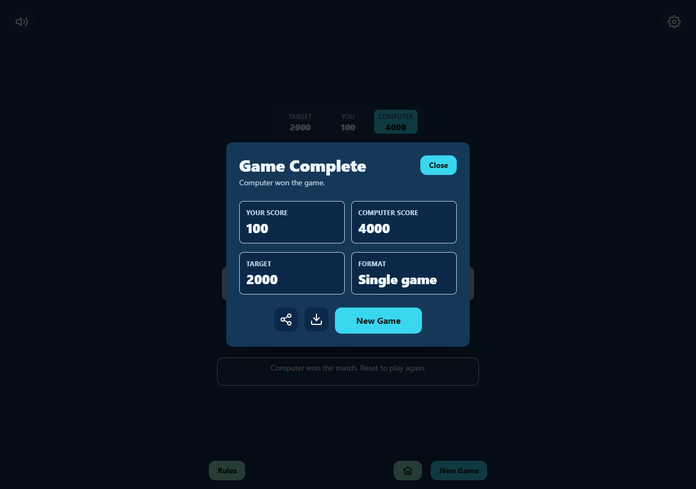
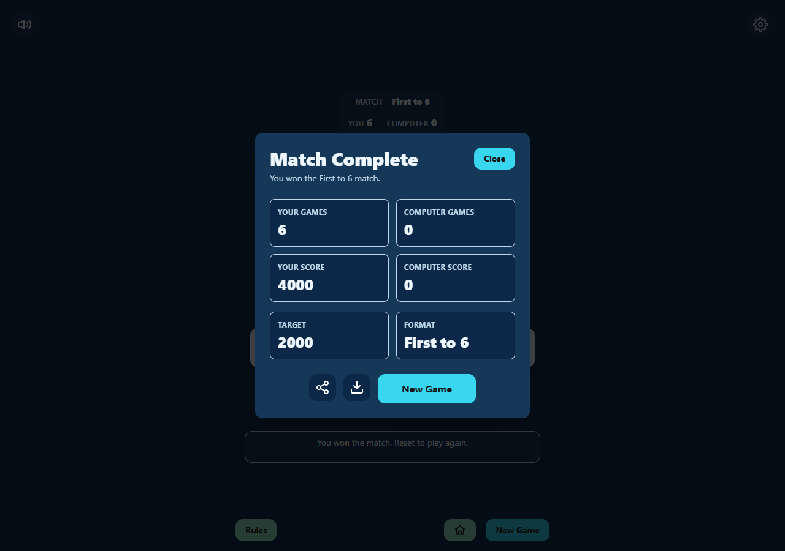

# VelociDice

[Play Farkle in your browser](https://velocidice.vercel.app/)

VelociDice is a browser-based Farkle-style dice game built with React, TypeScript, Vite, and Tailwind CSS. Players take turns selecting scoring dice, holding points, risking rerolls, and banking their round score before a Farkle wipes out the unbanked points.

For scoring combinations and turn rules, see [RULES.md](src/docs/RULES.md).


## Verified game flows

Playwright captures from the local game show the computer banking a winning hand
and a completed First to 6 match. See the [screenshot gallery](docs/screenshots/README.md)
for the updated scoring guide and verification details.





## Getting Started

Install dependencies:

```bash
npm install
```

Start the Vite development server:

```bash
npm run dev
```

## Test

Run the Vitest test suite in watch mode:

```bash
npm run test
```

Run tests once:

```bash
npm run test -- --run
```

## Lint

```bash
npm run lint
```

## Browser regression tests

Install Playwright's Chromium browser once, then run the game-flow checks:

```bash
npx playwright install chromium
npm run test:browser
```

The tests start their own development server on port 5175. They cover computer
banking, hot dice, First to 6 matches and existing records, and the in-game rules.
Screenshots and failure traces are written to the ignored `test-results` folder.
To use installed Microsoft Edge on Windows instead of downloading Chromium:

```powershell
$env:PLAYWRIGHT_BROWSER_CHANNEL = "msedge"
npm.cmd run test:browser
```

## Build

Create a production build:

```bash
npm run build
```

## Preview Build

Preview the production build locally:

```bash
npm run preview
```

## Roadmap

Anonymous aggregate game collection setup is documented in [analytics.md](docs/analytics.md).

Phase 4:

- Sound effects (DONE)
- Statistics
- Local save data
- Difficulty settings
