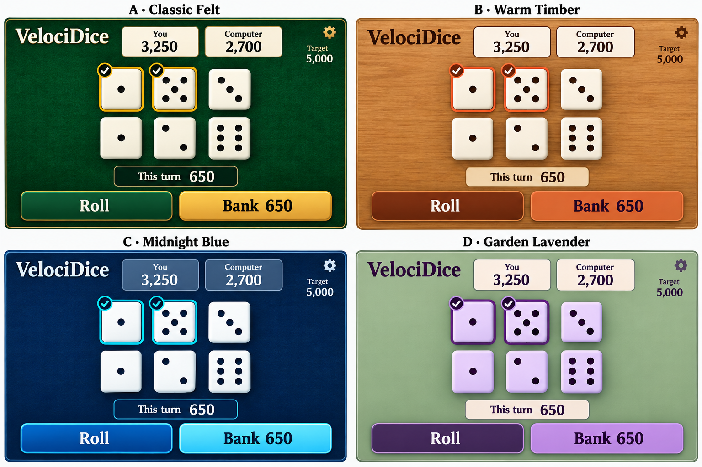

# Dice and table theme mockups

Concept comparison for VelociDice. All four directions selected for further consideration; these mockups do not change the game UI.

| Theme | Table | Dice | Accents |
| --- | --- | --- | --- |
| A: Classic Felt | Forest green felt | Ivory with dark pips | Gold |
| B: Warm Timber | Honey oak | Cream with brown pips | Terracotta |
| C: Midnight Blue | Deep navy | White with navy pips | Cyan |
| D: Garden Lavender | Muted sage | Lavender with plum pips | Violet |

Keep dice and text easy to read. Indicate selected dice with a border and a tick, in addition to colour. The image explores appearance; its layout and example scores are illustrative.

## Feature decisions to turn into GitHub issues later

- Daily Challenge mode. Detailed rules remain to be decided.
- Cloud backup/sync, with preservation of existing local records as a requirement. Account and recovery approach remains to be decided.
- Dice and table themes: retain all four concepts above. Independent dice/table selection remains an option to discuss.

No GitHub issues or commits are authorized by this document. Commits require express user approval.

## Interactive comparison including the current theme

Open [theme-comparison.html](theme-comparison.html) in a browser to compare all five themes or view one at a time. It is standalone and requires no dependencies or server.

The Current panel uses the app's charcoal palette, white dice, yellow selected dice, and blue/yellow action buttons, based on `src/theme/classes.ts` and `src/components/dice/DiceFace.tsx`. The shared comparison layout is illustrative, not an exact screenshot. Proposed panels include tick badges as a possible enhancement; the Current panel retains colour-only selection. No live application code or saved data is changed.

## Theme selection prototype

Open [theme-picker.html](theme-picker.html) for a proposed Settings → Appearance flow: five visual cards, a selected tick, a larger preview, and an explicit Use theme button. Original Charcoal is selected initially. Choices apply only inside the mockup for the current page session. On narrow screens the preview sits above the cards.

## Implemented theme selection

Settings → Theme now offers Original Charcoal, Classic Felt, Warm Timber, Midnight Blue, and Garden Lavender. Preview a choice and confirm with Use this theme. The selected theme is stored in the separate `velocidice.theme` local-storage entry and restored on subsequent browser sessions on the same browser/device. Existing `velocidice.records` data is not migrated or overwritten. If storage is blocked, the theme applies for the current visit and Settings explains that it could not be saved.

Additional requested concepts (mockups only): Las Vegas Casino, 80s Arcade, Flower Cottage, Christmas, Halloween, and Kitchen Tablecloth.

See [additional-theme-concepts.html](additional-theme-concepts.html) for the six new concepts and their position key, or open the [concept artwork](additional-theme-concepts.png) directly. All six are exploratory artwork, not implemented themes.

## Menu button colour proposals (feedback pending)

Open [menu-theme-comparison.html](menu-theme-comparison.html) to compare main menus and game previews for all eleven theme directions. Original Charcoal retains green Start, blue Rules and purple Stats; each other theme proposes three coordinated action colours. Filter individual themes or show all, and switch between Main menu and Game screen. These are mockup-only proposals; no application colours have been changed as part of this review.

The Points & status tab extends every theme proposal with active score highlighting, total/turn score increases, player/computer turn banners, success/error/warning/neutral notifications, available/selected/held/opponent dice, normal/hover/focus/disabled controls, and a colour-role key. Feedback on this full palette is pending; these changes are limited to mockup artifacts.

Layout updated for review: every theme now has one row with Main menu, Game screen, and Points & status side by side. Theme filtering remains available. On smaller screens each row scrolls horizontally to keep previews readable.

## Full palette review and opponent turn

Each theme row now includes Main menu, Your turn, Opponent turn, and Points & status. Both game screens use the same reviewed palette as the status examples, including held, opponent, selected, and active-score colours. Main game cards and score labels were also reviewed against their surfaces. Opponent controls are shown unavailable with an explicit waiting message.

Held dice now have individual theme directions: Original green; Felt pale sage; Timber slate blue; Midnight amber; Garden dusty rose; Vegas jade; Arcade hot pink; Cottage cornflower; Christmas cranberry; Halloween ghost mint; Tablecloth denim. Held dice include an outline and HELD label. Palette notes appear beneath each theme row. These are mockup-only revisions, pending feedback.

Contrast review: all 44 reviewed dice/pip and selected-badge colour pairs meet 4.5:1. New-theme menu button text, notification text and muted text were checked against their corresponding surfaces; Tablecloth muted text was darkened. Original Charcoal retains the requested familiar button colours as a reference, including its original white button labels; this reference is not claimed to meet the same text-contrast threshold. Contrast ratios do not replace visual review of theme backgrounds and state distinction.

Border-only selection now preserves the relevant player's available die face: player selections retain player available-die fill/pips; opponent selections retain opponent available-die fill/pips. Only the border and tick change. Original Charcoal retains its existing yellow selection treatment. Mockup-only change.

## Interactive colour alternatives and decisions

User-approved directions: Original Charcoal, Christmas, Classic Felt and 80s Arcade. These default to Decided. The review filter defaults to Needs review and can also show all or decided themes. Each row supports Mark decided / Reopen for review. Review decisions and colour choices persist only in the mockup's separate `velocidice.mockups.theme-review.v1` local-storage key.

Clickable alternatives update all four previews instantly: Midnight held (icy blue, periwinkle, steel blue, previous amber); Vegas held (rose gold, champagne, roulette black, previous jade); Cottage held (dusty rose, heather, terracotta, previous cornflower); Garden held (deep lavender, sage, mulberry, previous rose); Halloween held (lavender, pumpkin, ivory, purple — no green); Timber Start/Confirm (honey caramel, walnut, slate blue, warm taupe). These remain proposals; application code is unchanged.

User feedback: Walnut selected for Warm Timber Start/Confirm. Held colour is still under review. Added Timber held alternatives: burnished gold, smoky plum, muted teal and previous slate blue. Added Copy my choices to export all current browser-local decisions and selected colours as plain text, with a manual-copy fallback. Browser-local selections are not directly readable by the assistant.

Halloween now offers a separate Stats / Opponent turn colour selection: moonlit gold, haunted violet, dusky rose or burnt orange. This updates Stats buttons, selected menu options, opponent turn banners and associated colour-role swatches together, independently from held-die options. Included in Copy my choices exports. Mockup only.

All eleven themes now offer independent Held dice, Stats / Opponent turn, and Rules / Your turn alternatives. Existing groups and option indices are retained so saved decisions and selections survive refresh. New groups default to Current palette, with four coordinated alternatives per theme. Timber retains its additional Start/Confirm options. All groups are included in Copy my choices. Changes remain confined to mockups.

## Independent component editor

All themes now have a shared per-theme palette offered identically in each component dropdown. Warm Timber includes 24 named additional shades: walnut/espresso/cocoa/taupe, caramel/gold/cream, slate/denim/storm blue, plum/aubergine, teal/sage/olive and clay/copper/charcoal. Existing browser choices initialise independent component properties; review decisions are retained.

Independent properties: start_button, confirm_button, menu_selection, rules_button, stats_button, theme_button, your_turn, opponent_turn, reroll_button, bank_button, available, selected, opponent_available, opponent_selected, held, selection_border, active_score, point_increase, success_message, error_message, warning_message, neutral_message, focus_ring, disabled_surface, disabled_text, menu_surface, menu_text and table_surface. Selected dice can match their respective available-die colour or use a distinct fill. Contrasting foregrounds are selected automatically for surface colours. Expandable sections organise the controls; each property is independent.

Component choices persist to `velocidice.mockups.component-review.v2`; application settings/records and earlier review decisions are untouched. Copy my choices exports every component property. Changes are mockup-only; notification/focus colour combinations still require visual review.

## Additional concepts added

Added Coastal / Seaside, Art Deco, Porcelain / Blue Willow, Autumn Harvest, Marble & Brass, Space / Galaxy, Retro Diner and Australian Bush. Added three red-focused directions for the user's nanna: Red Velvet (ruby/champagne/ivory), Cherry Blossom (cherry/blush/cream), and Red & White Polka Dot (red/cream/blue accents). Retro Diner also features cherry red.

All eleven new directions participate in the same four-preview rows, independent component editor, shared per-theme colour options, reset controls, decision filters, browser-local persistence and Copy my choices export. Existing theme choices are retained. Twenty-two concepts total; all additions remain mockup-only.

## Swatch grids, component resets and custom colours

Replaced component dropdowns with compact grids of theme-colour swatches. Each component has an individual Reset and More colours button below its grid. More colours opens the browser/OS native colour picker; selecting a colour updates previews immediately and adds that custom colour to every component's shared palette for the theme. There is no separate standard-colours section. Selected swatches display a tick; the special Match available dice option is marked with a bidirectional arrow when unselected. Existing persistence, theme reset and export remain available.

## Side-by-side review layout

Every theme now has a left-hand colour-control panel and right-hand live-preview workspace. Each panel scrolls independently within the viewport. All four mockups remain available side by side, with local Menu / Your turn / Opponent turn / Points & status focus controls to keep one screen visible without horizontal scrolling. Narrow mobile layouts stack the preview above controls. Application unchanged.

## Six approved palettes implemented

The user's supplied component choices are now implemented for exactly the six marked DECIDED in their latest export: Original Charcoal, Classic Felt, Midnight Blue, Las Vegas Casino, 80s Arcade and Halloween. The definitive 28-role palettes are in `src/theme/palettes.ts`, including custom Charcoal grey #d8d8da and Vegas opponent pink #d5a5a6. Review-only themes remain here as mockups and are not offered in the app picker.

Buttons, menu selections, both turn banners, available/selected/opponent/held dice, active scores, point changes, notifications, focus rings and disabled states use independent properties. Text/pip foregrounds use the same automatic contrast choice as the mockups. A saved review-only theme ID falls back to Charcoal; existing records are unaffected. Theme choices still persist separately in `velocidice.theme`. No commits or GitHub issue changes are authorized by this implementation.
