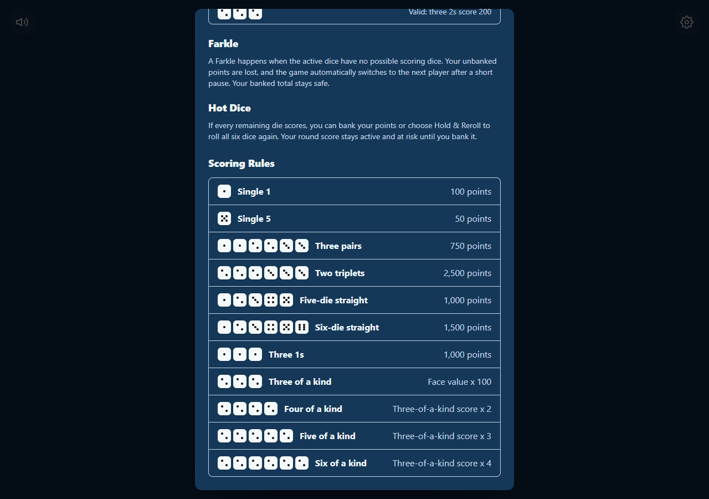

# Verified game screenshots

Captured with Playwright in Microsoft Edge on 31 October 2026 using the local
development server, an isolated browser profile, and the game's built-in debug
roll queue. These are real rendered game states; scores and outcomes are asserted
by the browser regression tests in [game-correctness.pw.ts](../../tests/browser/game-correctness.pw.ts).

## Computer banks a winning hand

Against a 2,000-point target, the computer banks six ones for 4,000 points and wins
instead of rerolling hot dice. The test also starts a new game afterward.

## First to 6 match completes

The match completes on the sixth game win. Setup, menu, match board, statistics,
and summaries use First to 6; historical records keep their existing storage key.
The test confirms that an existing four wins becomes five after this match.

## Updated scoring and turn guidance

The in-game guide includes two triplets for 2,500 points, explains automatic turn
changes after a Farkle, and makes the choice to bank or reroll hot dice explicit.

## Refreshing these images

Run `npm run test:browser` as described in the [main README](../../README.md#browser-regression-tests).
The tests write fresh captures into the ignored `test-results` folder. Review the
images, then copy the three named PNGs into this directory when intentionally
updating this documentation. Test runs do not overwrite these published examples.
